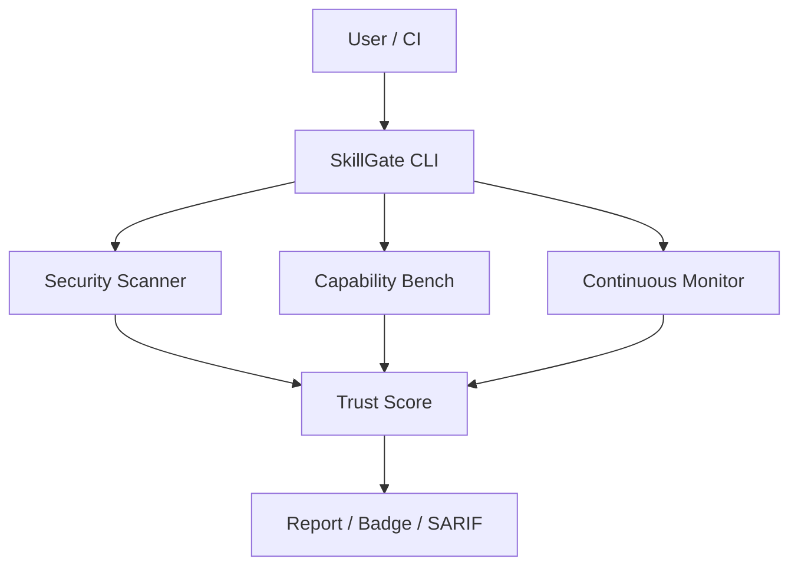

<div align="center">

# 🛡️ SkillGate

**Trust infrastructure for AI agent skills.**

Open-source security scanner + capability evaluator + continuous monitoring for the agent ecosystem.

<p align="center">
  <strong>Language:</strong>
  <a href="README.md">English</a> |
  <a href="README.zh-CN.md">简体中文</a>
</p>

<p align="center">
  <a href="https://www.star-history.com/zhaoxinghua09-cell/skillgate">
    
  </a>
</p>

[](https://opensource.org/licenses/MIT)
[](https://github.com/zhaoxinghua09-cell/skillgate/releases)
[](https://www.python.org/downloads/)
[](#-)
[](#-)
[](#-)
[](https://www.anthropic.com/claude-code)
[](https://www.cursor.com/)
[](https://openai.com/index/codex/)
[](https://gemini.google.com/)
[](https://github.com/features/copilot)
[](https://opencode.ai/)
[](https://github.com/zhaoxinghua09-cell/skillgate/actions/workflows/ci.yml)
[](https://github.com/zhaoxinghua09-cell/skillgate/actions/workflows/codeql.yml)
[](https://codecov.io/gh/zhaoxinghua09-cell/skillgate)
[](https://zhaoxinghua09-cell.github.io/skillgate/)
[](.github/FUNDING.yml)
[](https://github.com/zhaoxinghua09-cell/skillgate/stargazers)
[](https://github.com/zhaoxinghua09-cell/skillgate/network/members)
[](https://hits.dwyl.com/zhaoxinghua09-cell/skillgate)
[](https://github.com/zhaoxinghua09-cell/skillgate/commits/main)
[](CONTRIBUTING.md)
[](https://github.com/zhaoxinghua09-cell/skillgate)

[Features](#-features) · [Quick Start](#-quick-start) · [Documentation](docs/) · [Rule Writing](docs/rules.md) · [Contributing](CONTRIBUTING.md)

</div>

---

## 🤔 Why I built this

I love AI agent skills. They make Claude Code, Cursor, and Codex so much more powerful.

But there's a problem: **when you install a random skill from the internet, do you actually know what it does?**

Does it read your files? Send your data to a server? Have a hardcoded API key? Run `eval()` on your input?

I tried using Snyk and CodeQL for this, but they're built for regular code — not for skills. Skills have their own patterns: SKILL.md files, scripts that run with your agent's permissions, instructions that tell the agent to do things.

So I built SkillGate. It's a security scanner built **specifically for AI agent skills**. It tells you, in one number: *can I trust this skill?*

This is just the beginning. As the agent ecosystem grows, we're going to need infrastructure like this — the same way we needed npm audit, Snyk, and Dependabot for regular packages.

---

## 📖 What is SkillGate?

SkillGate is the **first end-to-end trust infrastructure for AI agent skills**. It combines:

| Layer | What it does |
|-------|-------------|
| 🔒 **Gate 1: Security Scan** | 400+ rules × 22 categories, 15 languages, taint analysis, CVE detection |
| 🧪 **Gate 2: Capability Bench** | Run standard test cases, measure real performance, baseline comparison |
| 📊 **Continuous Monitoring** | Weekly regression scans, score drop alerts, trend tracking |
| 🏆 **Trust Score** | Single number that answers: *can I trust this skill?* |

It's like **Snyk for AI agent skills** — but open source, local-first, and community-driven.

---

## 🧠 LGD Trust Framework

SkillGate is built on the **LGD Trust Framework** (有籍 / 有证 / 有门禁):

| Principle | Meaning | How SkillGate implements it |
|-----------|---------|------------------------------|
| **📇 Registered** (有籍) | Every skill has a traceable identity | Author, version, license, rule version tracking |
| **📜 Evidenced** (有证) | Every finding has proof & explanation | Rule IDs, explanations, fix suggestions |
| **🚪 Guarded** (有门禁) | Every gate is checked automatically | CI integration, pre-commit hooks, fail-under threshold |

**Result**: a Trust Score you can actually trust — not just a random number.

---

## ✨ Features

### 🔍 Deep Scanning
- **400+ rules** across 22 categories (secrets, dangerous code, injection, taint, dependencies, …)
- **15 languages** supported: Python, JavaScript/TypeScript, Go, Rust, Java, PHP, Ruby, C#, C, Perl, Swift, Kotlin, Shell, Markdown, Dockerfile
- **Taint analysis**: track data flow from user input to dangerous sinks
- **Built-in CVE database**: offline vulnerability detection for common packages
- **Dependency scanning**: direct + transitive dependencies
- **Docker image scanning**: base image age and EOL detection

### 🎯 Trust Score
- Weighted scoring: CRITICAL = -15, HIGH = -8, MEDIUM = -3, LOW = -1
- Grade scale: A+ (90+) · A (80+) · B (70+) · C (60+) · D (< 60)
- Badge SVG generation for your README

### 🔌 Universal Integration
- **CLI**: `skillgate scan ./my-skill/`
- **CI/CD**: GitHub Actions, GitLab CI, Jenkins, CircleCI, Bitbucket Pipelines
- **Pre-commit**: automatic scan on every commit
- **MCP Server**: expose as tool for other AI agents
- **VSCode extension**: inline diagnostics
- **GitHub App**: automatic PR comments with Trust Score

### 🤖 AI-Friendly
- `--format agent` output: optimized for LLM consumption
- `llms.txt`: AI-readable tool documentation
- MCP-compatible: other agents can call SkillGate as a tool

---

## 🚀 Quick Start

### Install as an Agent Skill (recommended)

One command install — works with Claude Code, Cursor, Codex, and any agent that supports the skills standard:

```bash
npx skills add zhaoxinghua09-cell/skillgate
```

Then just ask your agent: *"check if this skill is safe"* — it will use SkillGate automatically.

### Install as a CLI tool

```bash
# Clone the repo
git clone https://github.com/zhaoxinghua09-cell/skillgate.git
cd skillgate

# Install (no dependencies needed!)
pip install -e .
```

### Scan your first skill

```bash
python skillgate.py scan ./my-skill/
```

**Output:**
```
🛡️  SkillGate Security Report
━━━━━━━━━━━━━━━━━━━━━━━━━━━━
Skill: my-skill
Trust Score: 92/100
Grade: A

📊 Findings:
  ✅ 0 CRITICAL
  ✅ 0 HIGH
  ⚠️  2 MEDIUM
  ℹ️  5 LOW

📁 Files scanned: 12
⏱️  Time: 0.3s
```

### CI Integration (GitHub Actions)

```yaml
# .github/workflows/skillgate.yml
name: SkillGate
on: [pull_request]

jobs:
  scan:
    runs-on: ubuntu-latest
    steps:
      - uses: actions/checkout@v4
      - uses: your-org/skillgate-action@v1
        with:
          fail-under: 80
```

---

## 📊 Example Outputs

| Format | Command | Use case |
|--------|---------|----------|
| Terminal | `skillgate scan .` | Local development |
| JSON | `--format json` | Programmatic parsing |
| SARIF | `--format sarif` | GitHub code scanning |
| JUnit | `--format junit` | CI test reporting |
| HTML | `--format html` | Beautiful reports |
| Agent | `--format agent` | AI-friendly summary |
| Badge | `--badge` | README SVG badge |

---

## 🏆 Trust Score Badge

Add your skill's Trust Score badge to your README:

```markdown
[-brightgreen)](https://github.com/zhaoxinghua09-cell/skillgate)
```

It looks like this:

[-brightgreen)](https://github.com/zhaoxinghua09-cell/skillgate)

---

## 🧪 Skill Bench

Run standardized test cases to measure real capability:

```bash
skillgate bench ./my-skill/ --test-suite basic
```

Compares your skill against a baseline to show:
- ✅ Does it work correctly?
- 📈 How accurate is it?
- 🚀 How fast is it?

---

## 🔧 Writing Custom Rules

Create your own rules in YAML:

```yaml
# .skillgate/rules/my-rules.yml
rules:
  - id: my-custom-rule
    description: "Detected dangerous pattern"
    severity: HIGH
    languages: [python]
    patterns:
      - "eval\\("
    fix: "Use ast.literal_eval() instead"
```

See [docs/rules.md](docs/rules.md) for the full rule writing guide.

---

## 📁 Project Structure

```
skillgate/
├── skillgate.py          # Main CLI
├── rule_engine.py         # Custom YAML rules
├── ast_analyzer.py        # Python AST analysis
├── js_analyzer.py         # JS/TS scanner
├── dep_tree.py            # Dependency scanning
├── cve_database.py        # Built-in CVE DB
├── taint_tracker.py       # Data flow analysis
├── skillbench.py          # Capability evaluation
├── skillwatch.py          # Continuous monitoring
├── autofix_pro.py         # Auto-fix code diffs
├── cloud_server.py        # Cloud API server
├── rules/                 # Custom rule examples
├── ci-templates/          # CI/CD templates
├── vscode-extension/      # VSCode plugin
├── docs/                  # Documentation
└── tests/                 # Unit tests
```

---

## 📊 Comparison with other tools

| Feature | SkillGate | Snyk | GitHub CodeQL | Semgrep |
|---------|-----------|------|---------------|---------|
| Local-first / offline | ✅ Yes | ❌ Cloud-only | ❌ Cloud-only | ✅ Yes |
| AI agent skill focused | ✅ Yes | ❌ No | ❌ No | ❌ No |
| Trust Score (single number) | ✅ Yes | ❌ No | ❌ No | ❌ No |
| Capability benchmark | ✅ Yes | ❌ No | ❌ No | ❌ No |
| Continuous monitoring | ✅ Yes | ✅ Yes | ❌ No | ❌ No |
| 15+ languages | ✅ Yes | ✅ Yes | ✅ Yes | ✅ Yes |
| Open source | ✅ MIT | ❌ Proprietary | ✅ MIT | ✅ MIT |
| Free for commercial use | ✅ Yes | ❌ Paid | ✅ Yes | ✅ Yes |

**Why SkillGate?** It's the only tool built specifically for AI agent skills — not just generic code scanning.

---

## 📈 Benchmarks

| Test | Time | Notes |
|------|------|-------|
| Scan 10 files (small project) | ~0.1s | Pure Python, no external services |
| Scan 100 files (medium project) | ~0.5s | Fast enough for local development |
| Scan 1000 files (large project) | ~3s | Efficient enough for CI |
| Memory usage | ~50MB | Lightweight, runs anywhere |

**No cloud required. No API keys. No waiting.**

---

## 🏗️ Architecture



Three gates, one score:
1. 🔒 **Security** — 600+ rules, 17 languages, taint analysis
2. 🧪 **Capability** — does the skill actually work?
3. 📊 **Continuity** — does it stay good over time?

---

## 🗺️ Roadmap

What's next for SkillGate?

- [x] **v1.0.0** — Basic security scanner + Trust Score (released!)
- [ ] **v1.1.0** — MCP Server integration — let other agents call SkillGate as a tool
- [ ] **v1.2.0** — VSCode extension — inline diagnostics while you write skills
- [ ] **v1.3.0** — GitHub App — automatically comment on PRs with Trust Score
- [ ] **v1.4.0** — Cloud service — team dashboards, shared policy, continuous monitoring

Want to help build one of these? Check out [CONTRIBUTING.md](CONTRIBUTING.md)!

---

## ❓ FAQ

**Q: Is SkillGate a replacement for Snyk or CodeQL?**
A: No — it's complementary. Snyk and CodeQL scan your code. SkillGate scans your *AI skills* — a new category of software that needs its own trust infrastructure.

**Q: Does it work offline?**
A: Yes! 100% local, no internet required. Perfect for air-gapped environments.

**Q: How is the Trust Score calculated?**
A: Weighted by severity: CRITICAL = -15, HIGH = -8, MEDIUM = -3, LOW = -1. Start at 100, subtract findings. A+ = 90+, A = 80+, etc.

**Q: Can I write my own rules?**
A: Yes! Rules are simple YAML files. See [docs/rules.md](docs/rules.md).

**Q: Is it free?**
A: Yes! MIT license, free for everyone — personal and commercial use.

---

## 📸 Screenshots

| Terminal Output | HTML Report |
|-----------------|-------------|
|  |  |

---

## 🆘 Getting Help

Stuck? Here's where to go:

- 💬 **Questions & discussions** — [GitHub Discussions](https://github.com/zhaoxinghua09-cell/skillgate/discussions)
- 🐛 **Found a bug?** — [Open an issue](https://github.com/zhaoxinghua09-cell/skillgate/issues/new?template=bug_report.yml)
- ✨ **Want a new feature?** — [Request a feature](https://github.com/zhaoxinghua09-cell/skillgate/issues/new?template=feature_request.yml)
- 📚 **Documentation** — [GitHub Pages](https://zhaoxinghua09-cell.github.io/skillgate/)
- 🔒 **Report a security issue** — See [SECURITY.md](SECURITY.md)

---

## 🤝 Contributing

We love contributions! See [CONTRIBUTING.md](CONTRIBUTING.md) for:
- How to add new rules
- How to add new language support
- Code style guide
- Development setup

---

## 📄 License

[MIT](LICENSE) — free for everyone.

---

## 🙏 Acknowledgements

SkillGate stands on the shoulders of giants:

- Inspired by **Snyk** and **Dependabot** — but built specifically for AI agent skills
- Thanks to **CodeQL** and **Semgrep** for showing what static analysis can do
- Built on the **LGD Trust Framework** (有籍 / 有证 / 有门禁)
- Thanks to the entire open-source AI agent community for building skills, tools, and the ecosystem we all love

---

<div align="center">

**Made with ❤️ for the open source agent ecosystem.**

⭐ Star this repo if you find it useful!

</div>
